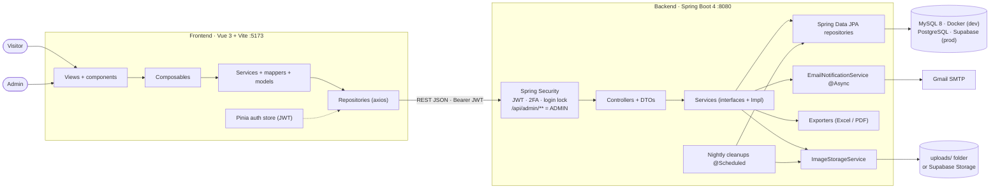
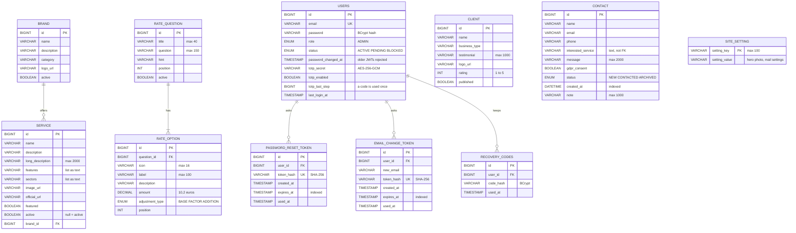
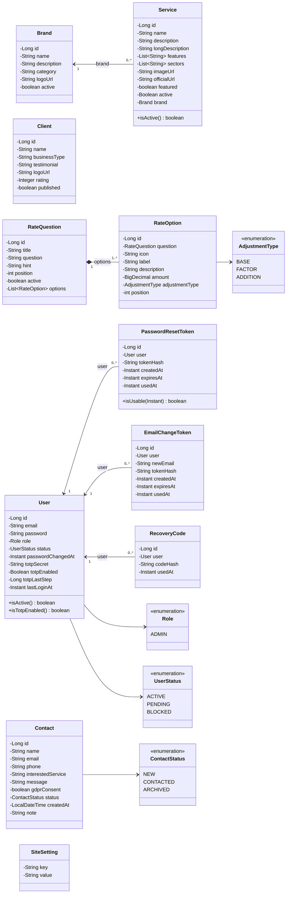
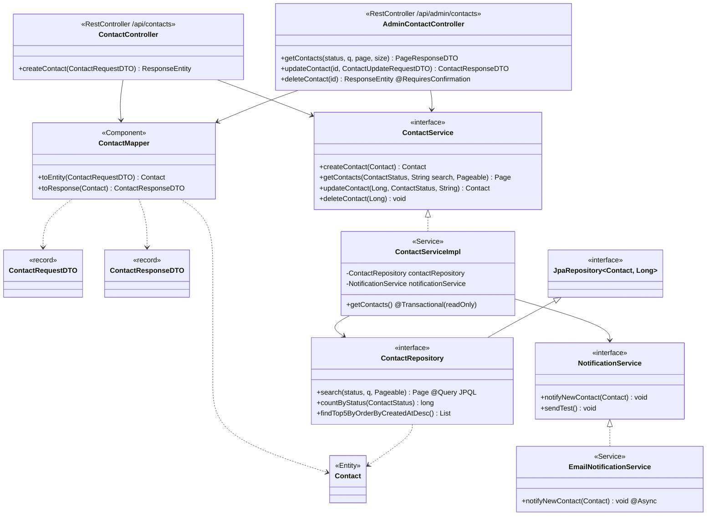
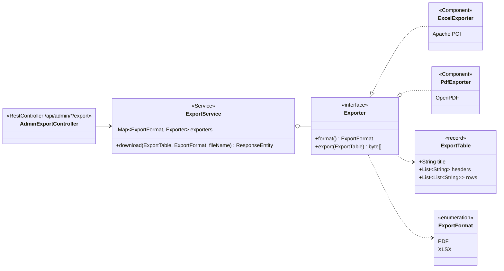
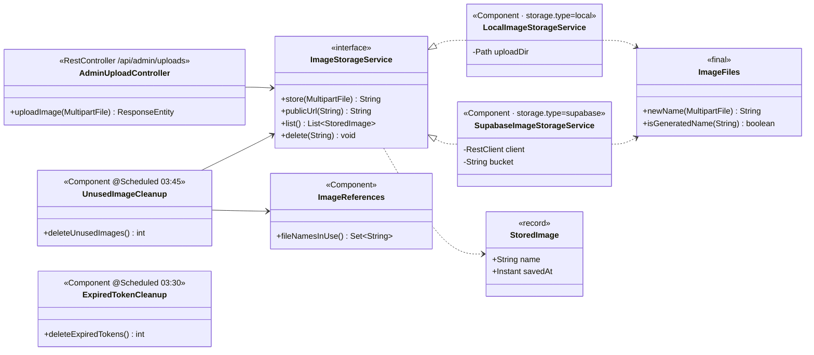
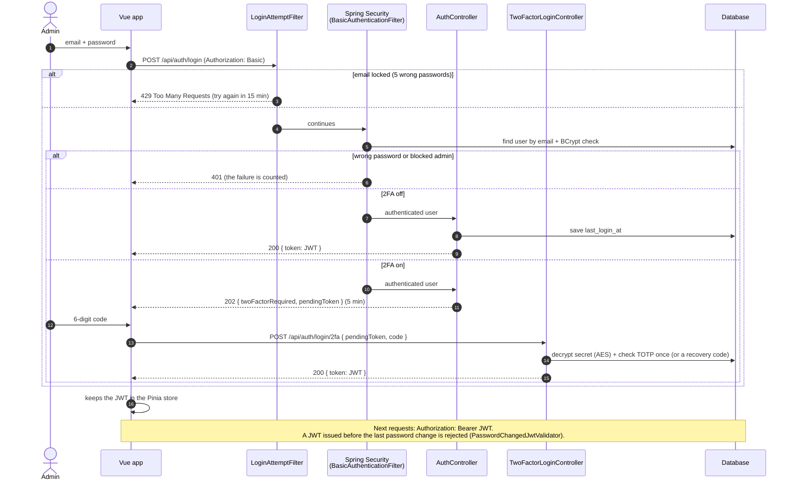
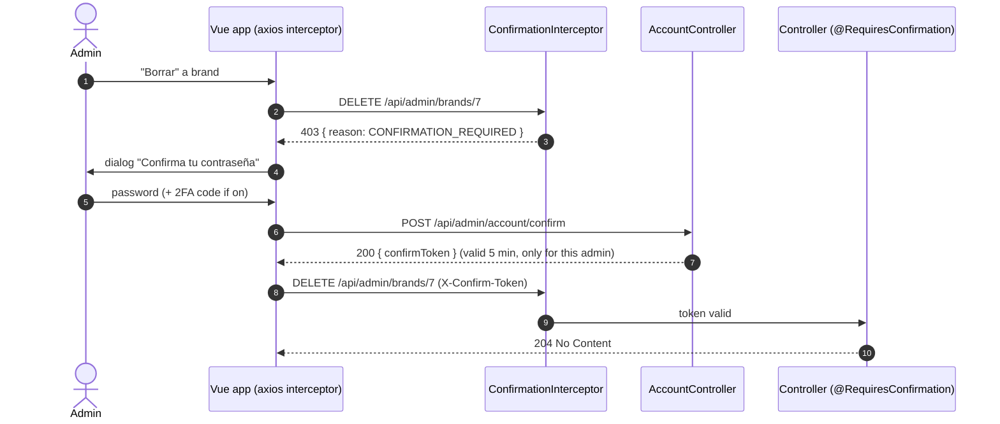

# Technical diagrams

Diagrams of the BG Sistemas Informáticos backend, written in [Mermaid](https://mermaid.js.org/) so GitHub draws them from the text (BGSI-168).
PNG versions for slides are in [`docs/diagrams/`](diagrams/). Updated with the security, search, database and storage work of October 2026.

1. [Architecture](#1-architecture)
2. [Entity-relationship diagram](#2-entity-relationship-diagram) (BGSI-6)
3. [Domain class diagram](#3-domain-class-diagram) (BGSI-7)
4. [Layers of one feature: Contact](#4-layers-of-one-feature-contact) (BGSI-7)
5. [Strategy pattern: export to Excel / PDF](#5-strategy-pattern-export-to-excel--pdf) (BGSI-7)
6. [Image storage: local folder or Supabase](#6-image-storage-local-folder-or-supabase) (BGSI-327)
7. [Login with two-step verification](#7-login-with-two-step-verification) (BGSI-274, BGSI-276)
8. [Password confirmation for sensitive actions](#8-password-confirmation-for-sensitive-actions) (BGSI-275)

## 1. Architecture

The Vue app calls the REST API with a JWT. Spring Security protects `/api/admin/**`, and every feature follows the same layers down to the database: MySQL in Docker for development, PostgreSQL on Supabase for production (same code, only the Spring profile changes). The images go to the `uploads/` folder or to Supabase Storage, and two nightly tasks delete what is no longer useful.

## 2. Entity-relationship diagram

Eleven tables. Foreign keys:

- `brand` 1 — 0..N `service` (`service.brand_id`). A brand with products cannot be deleted (409).
- `rate_question` 1 — 1..N `rate_option` (`rate_option.question_id`). Deleting a question deletes its options.
- `users` 1 — 0..N `password_reset_token`, `email_change_token` and `recovery_codes` (`user_id`). They are deleted with the admin.

Notes:

- `contact.interested_service` stores the product **name** as text on purpose: the lead keeps its history even if the product is deleted.
- Secrets are never stored in clear: passwords and recovery codes as BCrypt hashes, link tokens as SHA-256 hashes, and the 2FA secret encrypted with AES-256-GCM (the key is only in `.env`).
- Columns added later are nullable so the existing rows keep working: `service.active` null = active, `users.status` null = ACTIVE, `users.totp_enabled` null = off.
- Indexes (BGSI-326): `contact (status, created_at)` and `contact (created_at)` for the admin list; `expires_at` in both link tables for the nightly cleanup. Unique: `users.email`, `token_hash` of both link tables.
- In production (PostgreSQL on Supabase) the tables live in their own schema `app`, not in the public one.

## 3. Domain class diagram

JPA entities (`@Entity`) and their enums.

- `Service → Brand`: unidirectional many-to-one association (`@ManyToOne(fetch = LAZY)`).
- `RateQuestion ◆— RateOption`: bidirectional composition (`@OneToMany(cascade = ALL, orphanRemoval = true)`).
- `PasswordResetToken`, `EmailChangeToken`, `RecoveryCode → User`: unidirectional many-to-one (`@ManyToOne(fetch = LAZY)`). `User` does not know them, so loading an admin never loads its links.

## 4. Layers of one feature: Contact

Every feature (`brand`, `service`, `client`, `contact`, `rate`, `setting`...) uses the same layers:
**Controller → Mapper / DTO → Service (interface) → ServiceImpl → Repository → Entity**.
Controllers depend on the interface, and Spring injects the implementation through the constructor.
The admin lists search with one JPQL query with optional filters (`:q IS NULL OR ... LIKE :q ESCAPE '!'`, BGSI-302), the same in MySQL and PostgreSQL.

## 5. Strategy pattern: export to Excel / PDF

`ExportService` receives every `Exporter` bean and picks one by format. A new format only needs a new class that implements `Exporter`.

## 6. Image storage: local folder or Supabase

Dependency inversion: the upload controller and the nightly cleanup only know the `ImageStorageService` interface. `app.storage.type` (`STORAGE_TYPE` in `.env`) decides which implementation Spring creates: `local` (default, the `uploads/` folder) or `supabase` (a public bucket of Supabase Storage, served by its CDN). The database only keeps the URL of each image, never the image.

The nightly cleanups (`app.cleanup.cron` and `app.cleanup.images-cron`):

| Task | When | What it deletes |
|---|---|---|
| `ExpiredTokenCleanup` | 03:30 | Reset, invitation and email change links that expired more than a day ago |
| `UnusedImageCleanup` | 03:45 | Images older than a day that no brand, client, product or setting uses (old logos, photos of deleted products, images of cancelled forms). Nothing is deleted if the database cannot be read |

## 7. Login with two-step verification

The login is HTTP Basic (email + password) and the answer is a JWT (HS512, 8 hours). After 5 wrong passwords the email is locked for 15 minutes (BGSI-274). With two-step verification on (BGSI-276), the first step only gives a pending token for 5 minutes, and the JWT comes after the 6-digit code of the authenticator app (or a recovery code).

## 8. Password confirmation for sensitive actions

Every delete (brands, products, clients, contacts, rate questions and options), managing admins (invite, block, unblock, remove 2FA, delete), the mail settings, the email change and turning off 2FA are marked with `@RequiresConfirmation`. The server checks it, so calling the API directly without the confirmation also fails (BGSI-275).

