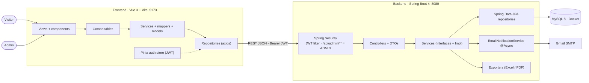
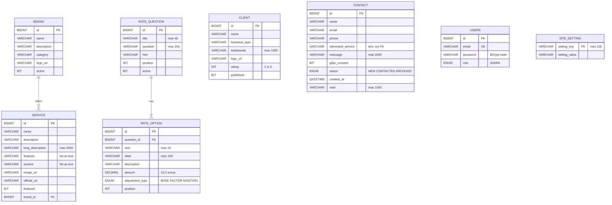
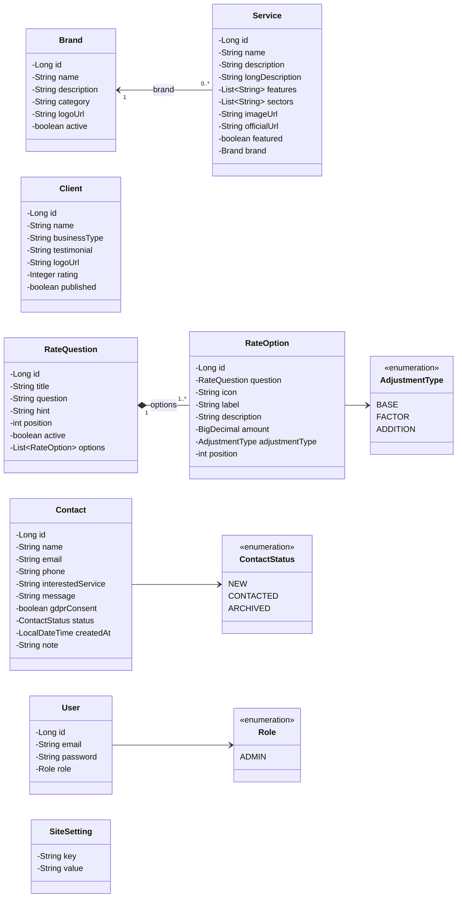
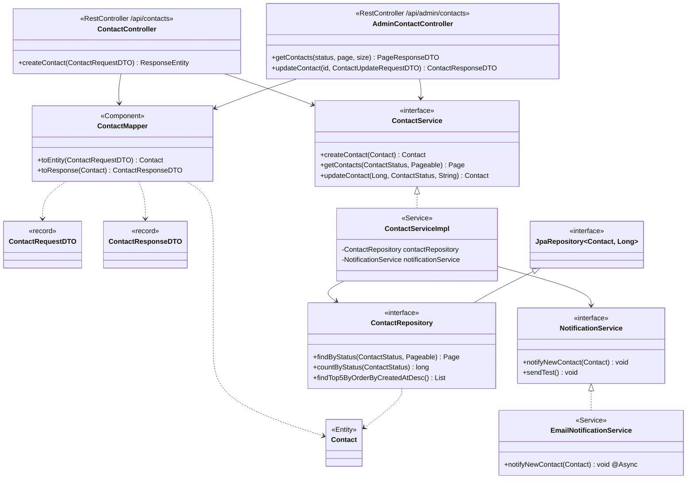
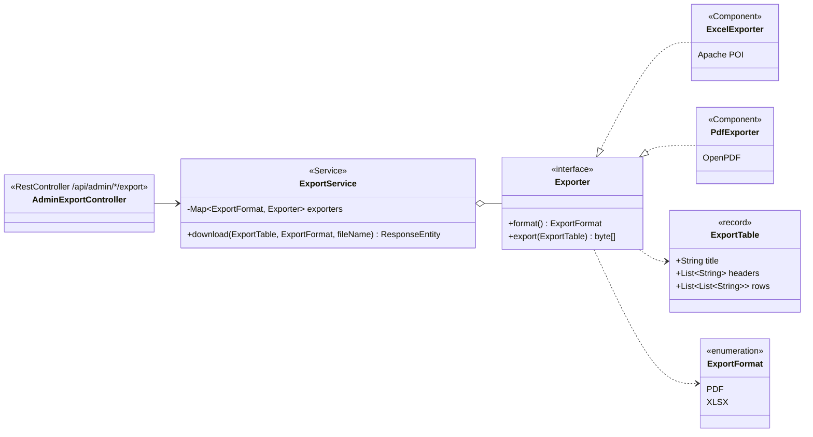

# Technical diagrams

Diagrams of the BG Sistemas Informáticos backend, written in [Mermaid](https://mermaid.js.org/) so GitHub draws them from the text (BGSI-168).
PNG versions for slides are in [`docs/diagrams/`](diagrams/).

1. [Architecture](#1-architecture)
2. [Entity-relationship diagram](#2-entity-relationship-diagram) (BGSI-6)
3. [Domain class diagram](#3-domain-class-diagram) (BGSI-7)
4. [Layers of one feature: Contact](#4-layers-of-one-feature-contact) (BGSI-7)
5. [Strategy pattern: export to Excel / PDF](#5-strategy-pattern-export-to-excel--pdf) (BGSI-7)

## 1. Architecture

The Vue app calls the REST API with a JWT. Spring Security protects `/api/admin/**`, and every feature follows the same layers down to MySQL (Docker).

## 2. Entity-relationship diagram

Eight MySQL tables. Only two relations use a foreign key:

- `brand` 1 — 0..N `service` (`service.brand_id`). A brand with products cannot be deleted (409).
- `rate_question` 1 — 1..N `rate_option` (`rate_option.question_id`). Deleting a question deletes its options.

`contact.interested_service` stores the product **name** as text on purpose: the lead keeps its history even if the product is deleted.

## 3. Domain class diagram

JPA entities (`@Entity`) and their enums.

- `Service → Brand`: unidirectional many-to-one association (`@ManyToOne`).
- `RateQuestion ◆— RateOption`: bidirectional composition (`@OneToMany(cascade = ALL, orphanRemoval = true)`).

## 4. Layers of one feature: Contact

Every feature (`brand`, `service`, `client`, `contact`, `rate`, `setting`...) uses the same layers:
**Controller → Mapper / DTO → Service (interface) → ServiceImpl → Repository → Entity**.
Controllers depend on the interface, and Spring injects the implementation through the constructor.

## 5. Strategy pattern: export to Excel / PDF

`ExportService` receives every `Exporter` bean and picks one by format. A new format only needs a new class that implements `Exporter`.

